**NAME:** YASMIEN GUILLERMO DE GUZMAN

**BLOCK:** IV-BSIT B

**COURSE:** ELEC 4 – PYTHON

# SET-1 ACTIVITIES
## P1 - Student Grade Calculator
**Description:** Calculates the highest, lowest, and average grades, including the PASS/FAIL status of students.

**Folder Link** 
[P1 - Student Grade Calculator](set1/p1/)

**Screenshots:** 

Student Grades Calculator
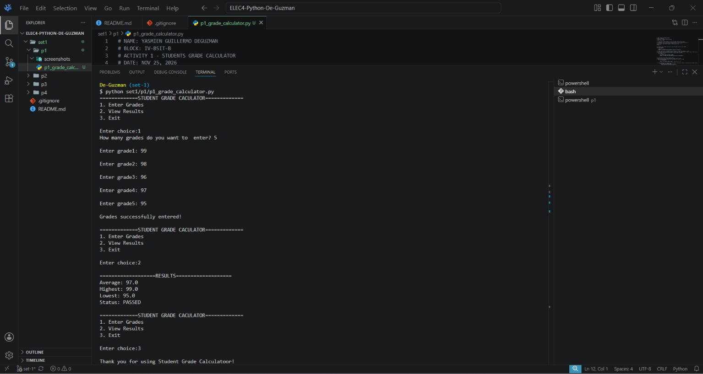

**How to Run the Programs**
python set1/p1/p1_grade_calculator.py

## P2 - Student Utilities
**Description:** Uses a custom Python module to perform student grade calculations.

**Folder Link**
[P2 - Student Utilities](set1/p2/)

**Screenshots:** 

Student Utilities
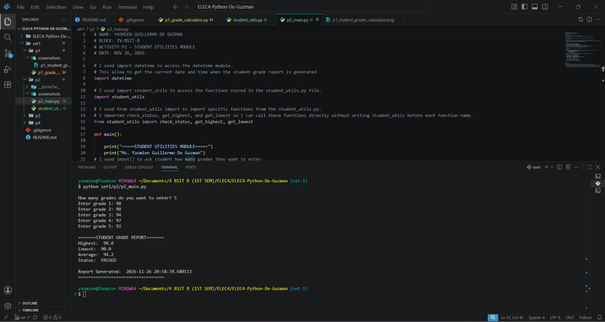

**How to Run the Programs**
python set1/p2/p2_main.py

## P3 - Student Record Manager
**Description:** Manages student records using list and set.

**Folder Link**
[P3 - Student Record Manager](set1/p3/)

**Screenshots:** 

Add Student
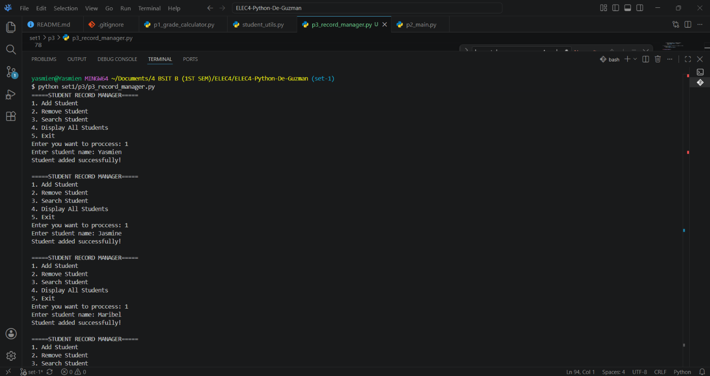

Display Students
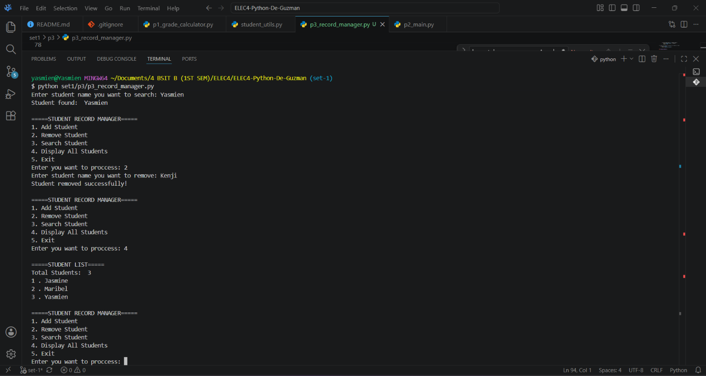

Duplicate Prevention
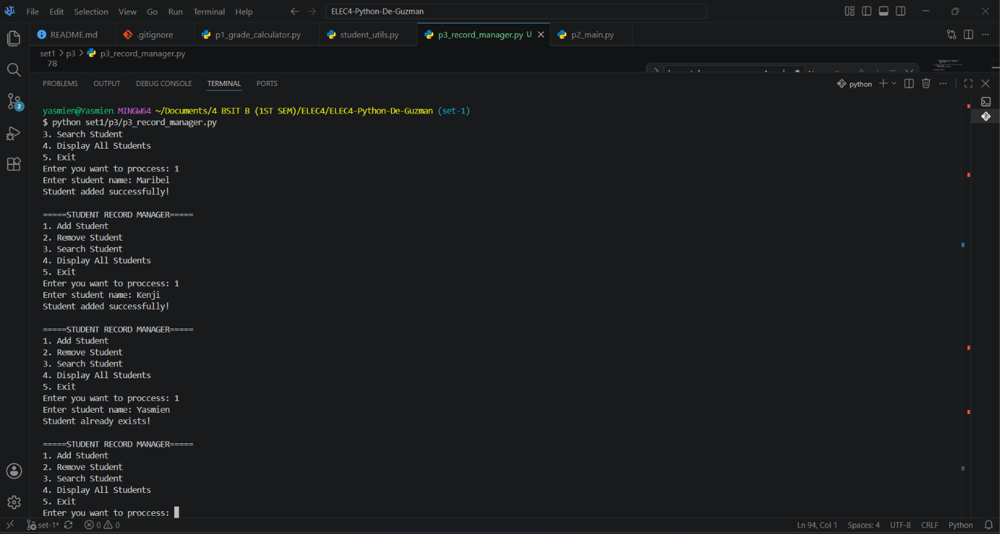

Remove Student
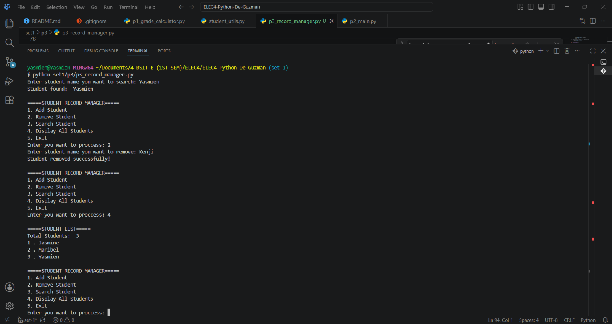

Search Student
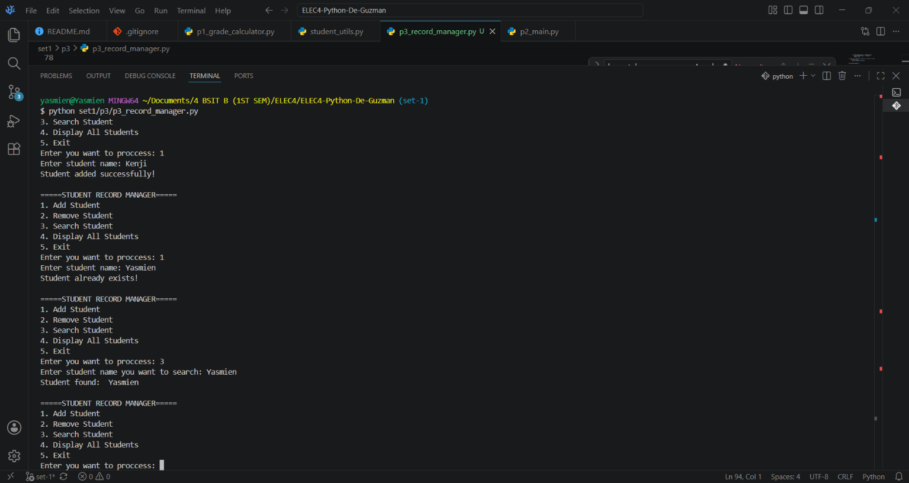

**How to Run the Programs**
python set1/p3/p3_record_manager.py

## P4 - Safe Menu Program
**Description:** Uses exception handling to manage invalid inputs, division by zero, missing files, and invalid menu choices.

**Folder Link**
[P4 - Safe Menu Program](set1/p4/)

**Screenshots:**

Invalid Number
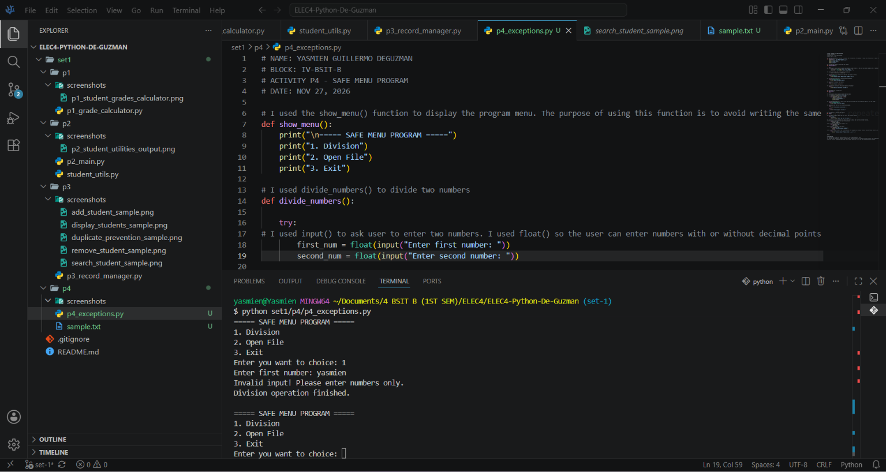

Division by Zero
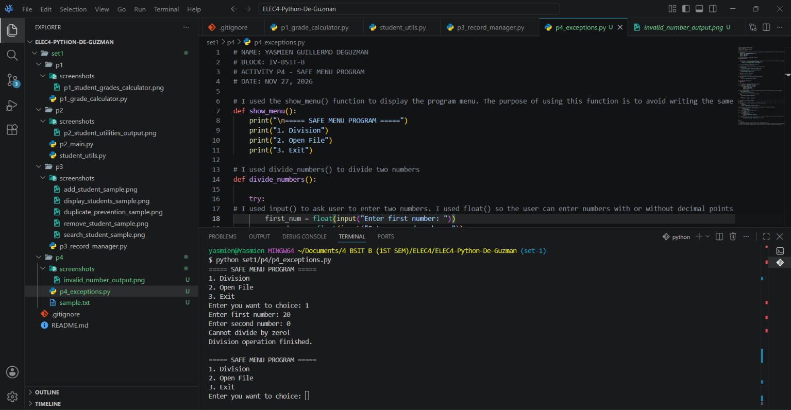

Missing File
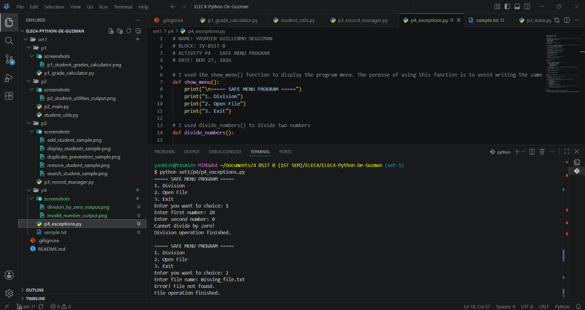

Invalid Menu Choice
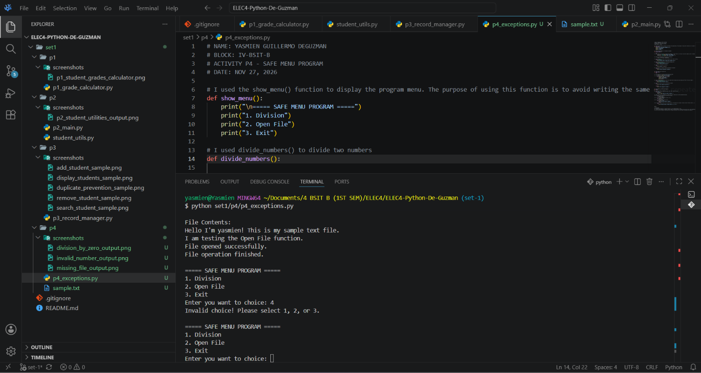

Successful File Opening
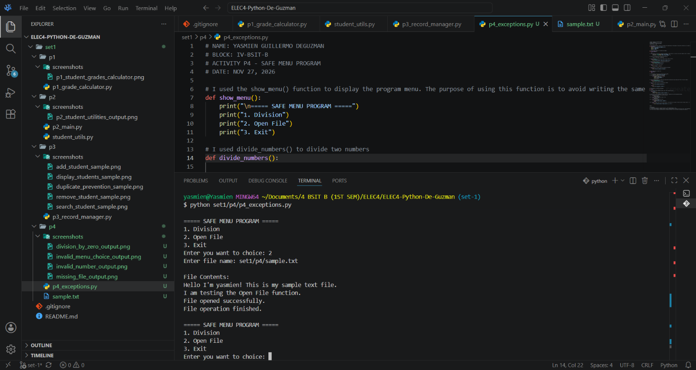

**How to Run the Programs**
python set1/p4/p4_exceptions.py

